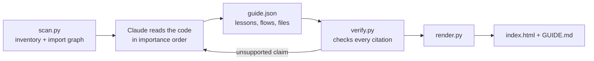

<p align="center">
  
</p>

<h1 align="center">Onramp</h1>

<p align="center">
  <strong>Understand any codebase.</strong><br>
  A route through the code, sized to the time you have, where every claim is checked against the code.
</p>

<p align="center">
  <a href="https://sanyamwadhwa07.github.io/onramp/">Website</a> ·
  <a href="https://sanyamwadhwa07.github.io/onramp/demo/papermind/">Live demo</a> ·
  <a href="#install">Install</a> ·
  <a href="#how-it-works">How it works</a>
</p>

<p align="center">
  <a href="https://github.com/SanyamWadhwa07/onramp/actions/workflows/test.yml"></a>
  <a href="LICENSE"></a>
  
  
</p>

---

You open a repository you didn't write, or one Claude wrote for you, and you can't tell what does what.

Onramp is a skill for Claude Code. It reads the project and builds you a guide: one HTML page that asks how much time you have and what you want to do, then plans a route through the code, stop by stop, from "what is this" down to the internals. Every technical claim links to the exact lines it comes from, and a script checks that those lines say what the guide says before the guide is built.

## Install

**With the skills CLI** (installs for Claude Code, and for other agents that read `SKILL.md`):

```bash
npx skills add SanyamWadhwa07/onramp
```

**As a Claude Code plugin:**

```
/plugin marketplace add SanyamWadhwa07/onramp
/plugin install onramp@onramp
```

**By hand:**

```bash
git clone https://github.com/SanyamWadhwa07/onramp
cp -r onramp/skills/onramp ~/.claude/skills/onramp
```

Onramp needs Python 3.8 or newer. There is nothing else to install.

## Use

Open Claude Code in any project and run:

```
/onramp
```

| Command | What you get |
|---|---|
| `/onramp` | The full guide for this repository, opened in your browser |
| `/onramp quick` | Only the 1-hour route: faster and cheaper |
| `/onramp explain src/auth/session.ts` | A deep lesson on one file, folder or function |
| `/onramp trace "user resets their password"` | One action followed through the code, step by step |
| `/onramp update` | The guide refreshed after the code changed |
| `/onramp tutor` | Claude teaches you the route in chat, with checkpoint questions |

Installed as a plugin, the command is `/onramp:onramp`.

The guide is written to `.onramp/` in your repository:

| File | What it is |
|---|---|
| `index.html` | The interactive guide. Opens from disk, no server. |
| `GUIDE.md` | The same content as markdown, for GitHub and for agents |
| `guide.json` | The source the page is built from |

## What makes it different

### A route, not a graph

You pick three things:

- **Time:** 1 hour, 1 day, 3 days or 1 week
- **Goal:** get the gist, ship a change, own it, or rebuild it
- **Background:** new to the stack, know the stack, or senior

Onramp plans a day-by-day route through the project and draws it as a road, with exits, rest stops and a "you are here" marker. Your progress and checkpoint answers are saved in the browser. One guide serves every route, because the planning happens in the page.

### Every claim is checked

A citation names a file, a line range, and a short piece of text from those lines:

```
[[app/store.py:29-38|def place_order(]]
```

`verify.py` opens every cited file. It checks that the lines exist and that they contain that text.

- If the line numbers drifted, it moves the citation to where the text really is.
- If the text is nowhere in the file, the check fails, and the claim has to be rewritten from the actual code.

The badge on every guide shows how many claims were checked and at which commit. When you click a citation, the code you see is copied from your file, never written by the model.

### Why it's built this way

Onramp reads the git history. If you say yes, it also reads your local Claude Code transcripts for the project. For a project you built with Claude, each file card then shows the prompt that led to the file and what Claude said when it made the change. Every decision in the guide is labelled *documented* or *inferred*.

### Learn it in the order it was built

The import graph gives a build order, from foundations to features. The "Rebuild it" route walks you through those milestones, with a hands-on task at each one.

### Twelve chapters, from the gist to the internals

The gist · Run it · The stack · The map · Core ideas · How it flows · Data and state · File by file · How it was built · Why it's like this · Handle with care · Your first changes

## How it works



1. **`scan.py`** takes inventory without a model and ranks which files to read first. It collects:
   - files, languages and lines of code
   - manifests, entry points and env vars
   - an import graph for JS/TS, Python, Go, Rust, Java/Kotlin, C/C++, Ruby and PHP
   - git history, and whether Claude session transcripts exist
2. **Claude reads the code** in that order. It follows real user actions from the entry point to storage and back, then writes `guide.json`: lessons with time estimates, plus flows, file cards, decisions, risks and exercises. On large repositories it fans out to one subagent per module.
3. **`verify.py`** checks every citation. Claude fixes whatever fails and runs it again until it passes.
4. **`render.py`** builds one self-contained HTML page, with the real code excerpts embedded, and a markdown copy.

The scripts use the Python standard library only.

## Privacy

- Onramp runs inside your own Claude Code session, and the scripts make no network calls.
- The guide is a local file. When opened, it fetches fonts, the diagram renderer and syntax colours from public CDNs. Without a connection it still works, with plain code and diagram source.
- Claude Code transcripts are read only if you agree, and they stay on your machine. Text that looks like an API key or token is redacted.
- To share a guide, render it with `--public`. This drops your local paths and points code links at GitHub.

## FAQ

**Will it change my code?**
No. Onramp only writes inside `.onramp/`. Add that folder to `.gitignore`, or commit `GUIDE.md` if your team wants it.

**How big a repository can it handle?**
The scanner is quick on repositories with tens of thousands of files. Claude reads the files that matter most first, and splits big codebases across subagents. On a very large monorepo, point it at the package you care about: `/onramp packages/api`.

**Does it work in Cursor, Codex or Gemini CLI?**
It is built and tested for Claude Code. The skills CLI installs it for any agent that reads `SKILL.md`, and the scripts are plain Python, so it should work wherever an agent can read files and run Python.

**Why are some old Claude sessions missing?**
By default, Claude Code deletes transcripts after about 30 days. Git history covers the rest.

## Development

```bash
python -m unittest discover -s tests -v
```

Repository layout:

```
skills/onramp/SKILL.md        the skill: workflow, modes, rules
skills/onramp/reference/      guide.json contract and the writing guide
skills/onramp/scripts/        scan.py, sessions.py, verify.py, render.py
skills/onramp/assets/         the guide viewer (HTML, CSS, JS, no build step)
docs/                         website and live demos (GitHub Pages)
tests/                        unit tests and the tinyshop fixture
```

Issues and pull requests are welcome.

## License

[MIT](LICENSE) © Sanyam Wadhwa
