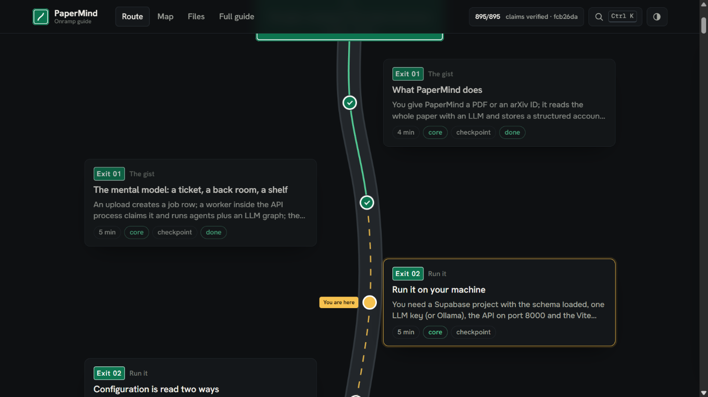
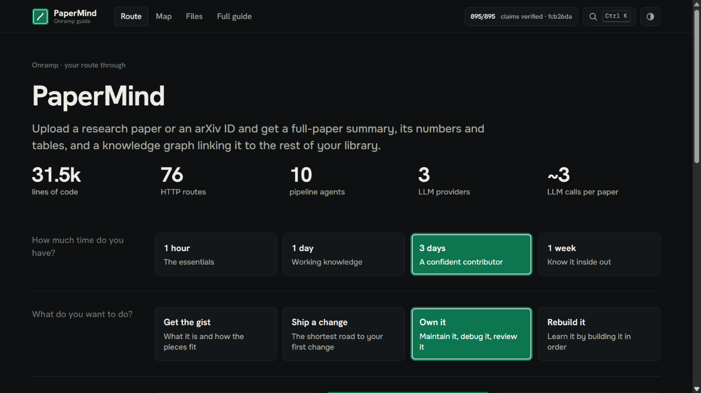
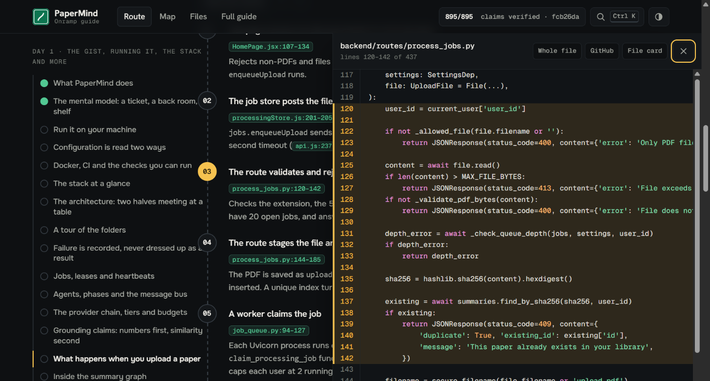
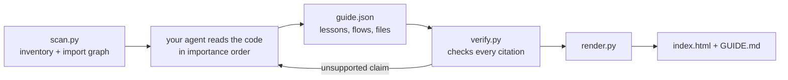

<p align="center">
  
</p>

<h1 align="center">Onramp</h1>

<p align="center">
  <strong>Understand any codebase.</strong><br>
  An agent skill that builds you a route through the code, sized to the time you have,<br>
  where every claim is checked against the code.
</p>

<p align="center">
  <a href="https://onramp-skill.vercel.app">Website</a> ·
  <a href="https://onramp-skill.vercel.app/demo/papermind">Live demo</a> ·
  <a href="#install">Install</a> ·
  <a href="#evaluation">Evaluation</a> ·
  <a href="#how-it-works">How it works</a>
</p>

<p align="center">
  <a href="https://github.com/SanyamWadhwa07/onramp/actions/workflows/test.yml"></a>
  <a href="https://github.com/SanyamWadhwa07/onramp/releases/latest"></a>
  <a href="LICENSE"></a>
  
  
</p>

<p align="center">
  
</p>

You open a repository you didn't write, or one your coding agent wrote for you, and you can't
tell what does what.

Onramp reads the project and builds a guide you can actually learn from. It asks how much time
you have and what you want to do, then plans a route through the code, stop by stop, from "what
is this" down to the internals. Every technical claim links to the exact lines it comes from,
and a script checks that those lines say what the guide says before you ever see it.

## Install

```bash
npx skills add SanyamWadhwa07/onramp
```

The [skills CLI](https://github.com/vercel-labs/skills) finds the agents on your machine and
installs Onramp into the ones you pick: Claude Code, Codex, GitHub Copilot, Cursor, Gemini CLI,
Antigravity, Windsurf, OpenCode, Cline and 60+ more. Name them directly with
`-a codex -a cursor`.

<details>
<summary>Other ways to install</summary>

**Claude Code plugin**

```
/plugin marketplace add SanyamWadhwa07/onramp
/plugin install onramp@onramp
```

**Git**

```bash
git clone https://github.com/SanyamWadhwa07/onramp
cp -r onramp/skills/onramp ~/.claude/skills/onramp      # Claude Code
cp -r onramp/skills/onramp ~/.agents/skills/onramp      # Codex, Cline, Zed and others
```

**Download** the skill folder as a zip from the
[latest release](https://github.com/SanyamWadhwa07/onramp/releases/latest) and unzip it into your
agent's skills folder.

</details>

Onramp needs Python 3.8 or newer. There is nothing else to install.

## Use

In Claude Code:

```
/onramp
```

In any other agent, ask in plain words: *"use onramp to explain this repo"*.

| Ask for | What you get |
|---|---|
| `/onramp` | The full guide for this repository, opened in your browser |
| `/onramp quick` | Only the 1-hour route: faster and cheaper |
| `/onramp explain src/auth/session.ts` | A deep lesson on one file, folder or function |
| `/onramp trace "user resets their password"` | One action followed through the code, step by step |
| `/onramp update` | The guide refreshed after the code changed |
| `/onramp tutor` | Your agent teaches you the route in chat, with checkpoint questions |

Everything is written to `.onramp/` in your repository. Your code is never modified.

| File | What it is |
|---|---|
| `index.html` | The interactive guide. One file, opens from disk, no server. |
| `GUIDE.md` | The same guide as markdown, for GitHub and for other agents |
| `guide.json` | The source the page is built from |

## What you get

<p align="center">
  
</p>

**A route, not a pile.** Pick your time (1 hour, 1 day, 3 days, 1 week), your goal (get the gist,
ship a change, own it, rebuild it) and your background. Onramp plans a day-by-day route and draws
it as a road with exits, rest stops, checkpoints and a "you are here" marker. Longer routes add
hands-on stops: reading key files in full, doing exercises, building milestones yourself. Your
progress is saved in the browser.

<p align="center">
  
</p>

**Every claim checked.** A citation names a file, a line range and a short piece of text from
those lines, like `[[app/store.py:29-38|def place_order(]]`. `verify.py` opens every cited file
and checks the text is really there. Drifted line numbers are re-anchored; a claim whose text is
nowhere in the file fails and is rewritten from the code. Click a citation and the code you see
is copied from your file, never written by the model.

**Why it is built this way.** Onramp reads the git history, and with your permission your local
Claude Code transcripts, so decisions come with evidence: a commit, a doc, a comment, the prompt
that started it. Each decision is labelled *documented* or *inferred*.

**Twelve chapters, from the gist to the internals.** The gist · Run it · The stack · The map ·
Core ideas · How it flows · Data and state · File by file · How it was built · Why it's like this ·
Handle with care · Your first changes.

## Live demos

| Demo | What it is | Guide |
|---|---|---|
| **PaperMind** | A 31,575-line FastAPI + React research-paper app, built with an AI agent | [open](https://onramp-skill.vercel.app/demo/papermind) · 895/895 citations verified |
| **nanoGPT** | Andrej Karpathy's minimal GPT training repository | [open](https://onramp-skill.vercel.app/demo/nanogpt) · 496/496 citations verified |
| **Flask** | The Python web framework, at the commit the evaluation uses | [open](https://onramp-skill.vercel.app/demo/flask) · 701/701 citations verified |

The PaperMind guide also shows what an honest guide looks like: its "Handle with care" chapter
cites real bugs in the code, such as upload retries that can never succeed and grounding results
that are computed and then dropped.

## Evaluation

Onramp is measured with three established methods. Every prompt, answer and grade is in
[`evals/`](evals/), and the method is written up in [`evals/README.md`](evals/README.md).

<!-- EVAL-RESULTS:START -->
| Question | Method | Result |
|---|---|---|
| Does the checker catch broken citations? | Fault injection on 2 real guides | **525 / 525** planted faults caught, **0** false alarms on 200 real citations |
| Are the guide's statements about the code true? | FActScore (Min et al., EMNLP 2023), blind, evidence-checked | **96.7%** of sampled claims supported (baseline document: 100%) |
| Does the guide help answer real questions? | SWE-QA, 48 Flask questions (ACL Findings 2026), blind | **67.1 / 100**, level with the model's own knowledge of Flask (67.2), ahead of the README (63.6) |

Flask is a codebase the models already know well, so the comparison is conservative. The full
write-up, including what the numbers do not show, is in [`evals/README.md`](evals/README.md).
<!-- EVAL-RESULTS:END -->

## How it works



1. **`scan.py`** takes inventory without a model: files, languages, manifests, entry points, an
   import graph for JS/TS, Python, Go, Rust, Java/Kotlin, C/C++, Ruby and PHP, git history,
   env vars and deleted files. It ranks which files to read first.
2. **Your agent reads the code** in that order and follows real user actions from the entry point
   to storage and back. It writes lessons with time estimates, traced flows, file cards, the
   stack, the data model, build milestones, decisions, risks and exercises. On large
   repositories, agents that can start subagents split the work by module.
3. **`verify.py`** checks every citation and fails on any claim the code does not contain. The
   agent fixes what fails and runs it again.
4. **`render.py`** builds one self-contained HTML page with the real code excerpts embedded, and a
   markdown copy.

The scripts use the Python standard library only.

## Privacy

- Onramp runs inside your own agent session. The scripts make no network calls.
- The guide is a local file. It loads fonts, the diagram renderer and syntax colours from public
  CDNs when opened, and still works offline with plain code.
- Claude Code transcripts are read only if you agree, never leave your machine, and anything that
  looks like a key or token is redacted.
- To share a guide, render it with `--public`: local paths are dropped and code links point to
  GitHub.

See [SECURITY.md](SECURITY.md) for the details and how to report a vulnerability.

## FAQ

**Will it change my code?**
No. It only writes inside `.onramp/`. Add that folder to `.gitignore`, or commit `GUIDE.md` if your
team wants it.

**How big a repository can it handle?**
The scanner takes seconds even on large repositories. The PaperMind demo (31,575 lines, 186 files)
took about 50 minutes with three subagents. On a monorepo, point it at one package:
`/onramp packages/api`.

**Which agents does it work with?**
Any agent that supports the open Agent Skills format (`SKILL.md`) and can run Python. It has been
tested most in Claude Code. Session history reads Claude Code transcripts; everything else works
everywhere.

**Why are some old sessions missing?**
Claude Code deletes transcripts after about 30 days by default. Git history covers the rest.

## Contributing

Bug reports, ideas and pull requests are welcome. Start with [CONTRIBUTING.md](CONTRIBUTING.md).

```bash
python -m unittest discover -s tests -v
```

## License

[MIT](LICENSE) © Sanyam Wadhwa
